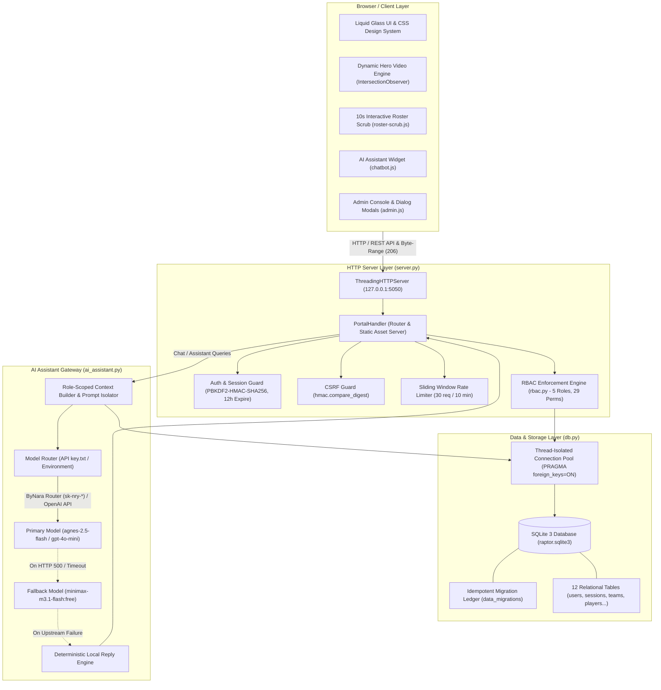

# Raptor Esports Portal

[](https://github.com/raptor-esports/portal/actions)
[](https://www.python.org/)
[](LICENSE)
[](https://www.sqlite.org/)
[](README.md)
[](tests/)

A modern, production-grade esports organization management portal and public showcase built exclusively with the **Python 3.10+ Standard Library** and browser-native HTML5, CSS3, and Vanilla JavaScript. The platform features an interactive public web showcase, a role-scoped management console, an enterprise-grade 5-role Role-Based Access Control (RBAC) engine, an ACID-compliant SQLite datastore, and a context-aware AI assistant gateway with dual-model failover.

---

## Table of Contents

1. [Executive Summary & Feature Highlights](#executive-summary--feature-highlights)
2. [System Architecture](#system-architecture)
3. [Role-Based Access Control (RBAC)](#role-based-access-control-rbac)
4. [REST API Reference](#rest-api-reference)
5. [Configuration & Environment Variables](#configuration--environment-variables)
6. [Local Development & Verification](#local-development--verification)
7. [Production Deployment Guide](#production-deployment-guide)
8. [Repository Structure](#repository-structure)
9. [Governance & Documentation Links](#governance--documentation-links)

---

## Executive Summary & Feature Highlights

The Raptor Esports Portal combines an immersive public-facing website with a secure back-office operational command center. Designed without heavy third-party framework overhead, it boots in milliseconds, requires zero external pip packages, and runs on any standard Python 3.10+ runtime.

```
       [ Public Visitors ]                   [ Esports Operations ]
                │                                      │
   ┌────────────▼──────────────┐             ┌─────────▼────────────────┐
   │ Liquid Glass Public Home  │             │ Role-Scoped Workspace    │
   │ • Looping Hero Video      │             │ • 5-Role RBAC Security   │
   │ • 10s Roster Scrub Stage  │             │ • Performance Analytics  │
   │ • Live Tournament Ticker  │             │ • Financial Ledger       │
   │ • Public AI Assistant     │             │ • Staff Delegation       │
   └────────────┬──────────────┘             └─────────┬────────────────┘
                │                                      │
                └───────────────┬──────────────────────┘
                                │
                  ┌─────────────▼────────────┐
                  │ Python Threading Server  │
                  │  (Zero External Packages)│
                  └─────────────┬────────────┘
                                │
                  ┌─────────────▼────────────┐
                  │ SQLite Thread-Safe Store │
                  └──────────────────────────┘
```

### Key Highlights

* **Liquid Glass Navigation & Dynamic Ticker**: Floating header with real-time blur backdrop filters, responsive mobile off-canvas drawer, and an automated continuous tournament marquee card rail (`assets/js/sections.js`) that pauses on hover or touch.
* **Cinematic Hero Video Engine**: Viewport-aware background video playback (`assets/js/hero-video.js`) utilizing `IntersectionObserver` to halt video decoding when scrolled out of view or tabbed away. Features opacity transition smoothing (`.video-live`) to eliminate initial black decode flashes, radial watermark masking, and fallback to high-resolution poster artwork under `prefers-reduced-motion`.
* **10-Second Interactive Roster Scrub Stage**: Sticky scroll-scrub interactive presentation (`assets/js/roster-scrub.js`) with `requestAnimationFrame` lerp playhead smoothing. Synchronizes user vertical scrolling with video playback (`assets/video/poseidon-scrub.mp4`) and triggers kinetic typography and 3-team morph crossfades across team rosters.
* **Role-Scoped Admin & Workspace Console**: Dedicated management dashboard (`admin.html`) with attribute-level permission gates (`data-permission`), native accessible modal dialogs (`<dialog>`), dynamic data filtering, and avatar selection.
* **Zero-Dependency AI Assistant Gateway**: Floating multi-mode conversational assistant (`ai_assistant.py`, `assets/js/chatbot.js`) supporting standard OpenAI-compatible endpoints, automatic ByNara router detection (`sk-nry-*`), secondary model failover, sliding-window rate limiting, and offline deterministic fallback.
* **Zero External Dependencies**: Built 100% on native standard libraries (`http.server`, `sqlite3`, `hashlib`, `hmac`, `secrets`, `urllib.request`). No pip installs, no node_modules, no vulnerability rot.

---

## System Architecture

The Raptor Esports Portal employs a clean multi-tier architecture separating presentation, HTTP transport, domain authorization, storage, and AI inference.



### Architecture Highlights
* **Thread-Per-Request Concurrency**: Handled natively by `http.server.ThreadingHTTPServer`.
* **Database Isolation**: Connections are created per transaction via `db.get_connection()`, setting `PRAGMA foreign_keys = ON` and a 10-second busy timeout to eliminate thread contention.
* **HTTP 206 Partial Content**: Native byte-range streaming for `.mp4` and `.webm` media files enables seamless video scrubbing without buffering full video files.
* **Timing Attack Mitigation**: Login checks execute a constant-computation dummy PBKDF2 hash on unknown accounts to protect against username enumeration side channels.

---

## Role-Based Access Control (RBAC)

The portal implements an explicit 5-role RBAC security model (`rbac.py`). Role levels (100 down to 50) provide ranking and display ordering; **permissions are never implicitly derived from levels** and are evaluated exclusively against explicit dictionary keys and resource scopes.

### Role Hierarchy & Definitions

| Role | Level | Default Identity | Scope Description |
| :--- | :---: | :--- | :--- |
| **Admin** | 100 | `admin@raptor.local` | Unrestricted global access across user accounts, system configuration, all data entities, and financials. |
| **Manager** | 80 | `manager@raptor.local` | Full operational control across all teams, rosters, matches, tournaments, and expenses. Cannot manage user accounts or system settings. Can assign coaches. |
| **Coach** | 70 | `coach@raptor.local` | Scoped to assigned teams (`user_team_assignments`). Manages player rosters, performance records, and drills. No financial access. |
| **Analyst** | 60 | `analyst@raptor.local` | Read-only analytical access to assigned teams, match results, and performance scores. Can adjust team rosters. No financial access. |
| **Player** | 50 | `player@raptor.local` | Strictly self-scoped access. Limited to personal profile, assigned team roster, and logging personal performance evaluations. |

### Granular 29-Permission Matrix

| Permission Key | Admin | Manager | Coach | Analyst | Player |
| :--- | :---: | :---: | :---: | :---: | :---: |
| `users.view_all` | `True` | `False` | `False` | `False` | `False` |
| `users.create` | `True` | `False` | `False` | `False` | `False` |
| `users.update_role` | `True` | `False` | `False` | `False` | `False` |
| `users.delete` | `True` | `False` | `False` | `False` | `False` |
| `teams.view_all` | `"all"` | `"all"` | `"assigned"` | `"assigned"` | `"own"` |
| `teams.create` | `True` | `True` | `False` | `False` | `False` |
| `teams.update` | `"all"` | `"all"` | `"assigned"` | `False` | `False` |
| `teams.delete` | `True` | `False` | `False` | `False` | `False` |
| `teams.assign_coaches` | `True` | `True`* | `False` | `False` | `False` |
| `roster.view` | `"all"` | `"all"` | `"assigned"` | `"assigned"` | `"own"` |
| `roster.create` | `"all"` | `"all"` | `"assigned"` | `"assigned"` | `False` |
| `roster.update` | `"all"` | `"all"` | `False` | `False` | `False` |
| `roster.delete` | `True` | `"all"` | `"assigned"` | `"assigned"` | `False` |
| `performance.view_all` | `"all"` | `"all"` | `"assigned"` | `"assigned"` | `"own"` |
| `performance.create` | `"all"` | `True` | `"assigned"` | `False` | `"own"` |
| `performance.update` | `"all"` | `"all"` | `"assigned"` | `False` | `False` |
| `performance.delete` | `True` | `False` | `False` | `False` | `False` |
| `matches.view_all` | `"all"` | `"all"` | `"assigned"` | `"assigned"` | `"own"` |
| `matches.create` | `True` | `True` | `False` | `False` | `False` |
| `matches.update` | `"all"` | `"all"` | `False` | `False` | `False` |
| `matches.delete` | `True` | `False` | `False` | `False` | `False` |
| `financial.view` | `"all"` | `"all"` | `False` | `False` | `False` |
| `financial.create` | `True` | `True` | `False` | `False` | `False` |
| `financial.update` | `"all"` | `"all"` | `False` | `False` | `False` |
| `financial.delete` | `True` | `False` | `False` | `False` | `False` |
| `reports.view` | `"all"` | `"all"` | `"assigned"` | `"assigned"` | `"own"` |
| `analytics.view` | `"all"` | `"all"` | `"assigned"` | `"assigned"` | `"own"` |
| `admin.access` | `True` | `False` | `False` | `False` | `False` |
| `system.configure` | `True` | `False` | `False` | `False` | `False` |

*\*Staff Assignment Rules (`rbac.can_assign_team_role`)*:
* `Admin` can assign staff members with target roles `coach` and `analyst`.
* `Manager` can assign staff members with target role `coach` only.
* Non-admin and non-manager accounts cannot assign staff.

### Resource Scoping Mechanics

Resource authorization is resolved dynamically on every operation via `rbac.resource_allowed()`:
* **Global Scope (`"all"` / `True`)**: Unchecked access across all database rows.
* **Assigned Scope (`"assigned"`)**: Permitted only if the entity record's `team_id` matches an entry in the user's `user_team_assignments` table.
* **Self Scope (`"own"`)**: Permitted only if `player_id == user.player_id` or `team_id == linked_player.team_id`. When players log performance scores, the server automatically forces `player_id` to the session's linked athlete.
* **Self-Protection Rule**: Administrators are explicitly barred from modifying their own role or deleting their own user account (`server.py`).

---

## REST API Reference

The portal exposes 22 JSON REST endpoints adhering strictly to HTTP standards. All mutating methods (`POST`, `PUT`, `DELETE`) require a valid `X-CSRF-Token` header. For comprehensive JSON request and response payloads, consult [docs/API.md](docs/API.md).

| # | Endpoint | Method | Auth / Role Scope | Description | Status Codes |
|---|---|:---:|---|---|:---:|
| 1 | `/api/public` | `GET` | Public (Unauthenticated) | Returns public statistics, active teams, and upcoming tournaments. | `200` |
| 2 | `/api/public/teams/{id}` | `GET` | Public (Unauthenticated) | Returns detail for an active team and its player roster. | `200`, `404` |
| 3 | `/api/login` | `POST` | Public | Authenticates credentials; returns user record, CSRF token, and sets `raptor_session` cookie. | `200`, `400`, `401`, `403` |
| 4 | `/api/logout` | `POST` | Authenticated | Terminates session in SQLite, clears `raptor_session` cookie. | `200`, `401`, `403` |
| 5 | `/api/me` | `GET` | Authenticated | Returns current profile, assigned team IDs, player ID, and permissions map. | `200`, `401`, `403` |
| 6 | `/api/chat/session` | `GET` | Optional Session | Returns visitor authentication status, role profile, and CSRF token. | `200` |
| 7 | `/api/chat` | `POST` | Session-Aware | Conversational chat completions. Public context for visitors; role-scoped context for users. Rate-limited. | `200`, `400`, `403`, `413`, `429` |
| 8 | `/api/assistant` | `POST` | Permission: `analytics.view` | Workspace admin assistant. Persists Q&A history to `assistant_messages` table. | `200`, `400`, `401`, `403` |
| 9 | `/api/dashboard` | `GET` | Permission: `analytics.view` | Workspace dashboard metrics, match ticker, and role-filtered audit events. | `200`, `401`, `403` |
| 10 | `/api/reports` | `GET` | Permission: `reports.view` | Aggregated roster metrics and financial totals (if authorized). | `200`, `401`, `403` |
| 11 | `/api/users` | `GET` | Admin Only (`users.view_all`) | Returns all user accounts, associated roles, and team assignments. | `200`, `401`, `403` |
| 12 | `/api/users` | `POST` | Admin Only (`users.create`) | Creates user account with PBKDF2 hashed credentials and role binding. | `201`, `400`, `401`, `403`, `409` |
| 13 | `/api/users/{id}` | `PUT` | Admin Only (`users.update_role`) | Updates account role and replaces assigned teams. Self-role edit blocked. | `200`, `400`, `401`, `403`, `404` |
| 14 | `/api/users/{id}` | `DELETE` | Admin Only (`users.delete`) | Deletes user account and cascades sessions. Self-deletion blocked. | `200`, `401`, `403`, `404` |
| 15 | `/api/assignments` | `GET` | Admin / Manager (`teams.assign_coaches`) | Lists staff team assignments (Admin sees all; Manager sees coaches). | `200`, `401`, `403` |
| 16 | `/api/coaches` | `GET` | Admin / Manager (`teams.assign_coaches`) | Lists eligible staff for assignment (Admin: coach/analyst; Manager: coach). | `200`, `401`, `403` |
| 17 | `/api/assignments` | `POST` | Admin / Manager (`teams.assign_coaches`) | Maps staff member to team. Manager restricted to coach role. | `201`, `400`, `401`, `403`, `404` |
| 18 | `/api/assignments/{user_id}/{team_id}` | `DELETE` | Admin / Manager (`teams.assign_coaches`) | Removes staff team assignment. Manager restricted to coach role. | `200`, `401`, `403`, `404` |
| 19 | `/api/entities/{table}` | `GET` | Role Scoped (`view` on table) | Lists records from `players`, `teams`, `tournaments`, `matches`, `expenses`, `performance_records`. | `200`, `401`, `403`, `404` |
| 20 | `/api/entities/{table}` | `POST` | Role Scoped (`create` on table) | Creates entity row. Automatically verifies team boundaries and schema validation. | `201`, `400`, `401`, `403`, `409` |
| 21 | `/api/entities/{table}/{id}`| `PUT` | Role Scoped (`update` on table) | Modifies entity record with origin and target scope verification. | `200`, `400`, `401`, `403`, `404`, `409` |
| 22 | `/api/entities/{table}/{id}`| `DELETE`| Role Scoped (`delete` on table) | Deletes entity record. Foreign key dependencies guarded. | `200`, `401`, `403`, `404`, `409` |

---

## Configuration & Environment Variables

All settings can be supplied via environment variables or a root credential file.

### Supported Environment Variables

| Variable | Default Value | Purpose |
| :--- | :--- | :--- |
| `RAPTOR_DB_PATH` | `data/raptor.sqlite3` | Custom filesystem path for SQLite database file. Parent directory created automatically. |
| `RAPTOR_DEMO_PASSWORD` | `Raptor@2026` | Initial password applied when seeding demo accounts (`admin@raptor.local`, etc.). |
| `OPENAI_API_KEY` | *(Loaded from `API key.txt`)* | API key for OpenAI-compatible chat completions. If unset or empty, operates in Local Fallback mode. |
| `OPENAI_BASE_URL` | *(Inferred or `API key.txt`)* | Upstream API base URL. Automatically resolves to `https://router.bynara.id/v1` for `sk-nry-*` keys, else `https://api.openai.com/v1`. |
| `OPENAI_MODEL` | *(Loaded from `API key.txt`)* | Primary chat model identifier (defaults to `agnes-2.5-flash` or `gpt-4o-mini`). |
| `OPENAI_FALLBACK_MODEL` | *(Loaded from `API key.txt`)* | Secondary model queried if the primary model returns an HTTP error or times out (defaults to `minimax-m3.1-flash:free`). |
| `OPENAI_KEY_FILE` | `API key.txt` | Custom file path for multi-line credentials file. |

### `API key.txt` File Format

For local development without environment variables, create `API key.txt` in the workspace root with the following 4-line structure:

```text
sk-nry-demo-secret-key-token
agnes-2.5-flash
minimax-m3.1-flash:free
https://router.bynara.id/v1
```

* **Line 1**: API key (Required for remote LLM).
* **Line 2**: Primary model name.
* **Line 3**: Fallback model name.
* **Line 4**: *(Optional)* Base URL. If omitted and key starts with `sk-nry-`, defaults to `https://router.bynara.id/v1`.
* **Security Guard**: `server.py` strictly refuses to serve `API key.txt` over HTTP (returns HTTP 404).

---

## Local Development & Verification

### Prerequisites
* **Python 3.10** or newer (`python --version`)
* No external packages required (uses Python standard library exclusively)

### Step-by-Step Setup

1. **Clone or Navigate to the Workspace**:
   ```powershell
   cd c:\Users\bhale\Downloads\create-an-actual-working-website-using
   ```

2. **Start the Web Server**:
   ```powershell
   python server.py
   ```
   *The server binds to `127.0.0.1:5050` and outputs:*
   ```text
   Raptor Esports Portal running at http://127.0.0.1:5050
   ```

3. **Access the Portal**:
   * Public Portal: [http://127.0.0.1:5050](http://127.0.0.1:5050)
   * Login Page: [http://127.0.0.1:5050/login](http://127.0.0.1:5050/login)
   * Workspace Dashboard: [http://127.0.0.1:5050/dashboard](http://127.0.0.1:5050/dashboard)

### Default Demo Credentials

On first run, `db.initialize()` provisions demo accounts with salted PBKDF2-HMAC-SHA256 password hashes:

| Role | Email / Username | Password | Assigned Scope |
| :--- | :--- | :--- | :--- |
| **Admin** | `admin@raptor.local` | `Raptor@2026` | Global access (all modules, users, finances) |
| **Manager** | `manager@raptor.local` | `Raptor@2026` | Global operations, rosters, matches, expenses |
| **Coach** | `coach@raptor.local` | `Raptor@2026` | Assigned to Team 1 (`Raptor (BGMI)`) |
| **Analyst** | `analyst@raptor.local` | `Raptor@2026` | Assigned to Team 1 (`Raptor (BGMI)`) |
| **Player** | `player@raptor.local` | `Raptor@2026` | Linked to Player 1 (`Sanku`, Team 1) |

### Optional Realistic Performance Seeding

To seed 15+ historical competitive scrim ratings and performance metrics:
```powershell
python seed_performance.py
```
*(This script is idempotent and records `performance_seed_v1` in `data_migrations`).*

### Running the Test Suite

Execute the full unit and integration test suite:

```powershell
python -m unittest discover -s tests -v
```

All **48 tests** execute cleanly in ~10 seconds:
* `test_chatbot.py` (23 tests): Public vs authenticated chat contexts, CSRF verification, rate limiting, key file parsing, upstream dual-model failover.
* `test_player_avatars.py` (10 tests): Avatar seeding, round-robin distribution, validation guards, backward compatibility.
* `test_rbac.py` (8 tests): 5 explicit roles, 29-permission matrix assertions, resource scoping boundaries, coach delegation rules.
* `test_rbac_database.py` (3 tests): Concurrency, foreign-key pairing validation, schema migration.
* `test_rbac_routes.py` (4 tests): Route permission dispatch, wildcard entity table regex matching, admin-only route locking.

---

## Production Deployment Guide

In a production environment, the Python service should run bound to loopback `127.0.0.1:5050` managed by `systemd`, fronted by a hardened reverse proxy (such as Nginx or Caddy) handling TLS/SSL termination, HTTP/2 or HTTP/3, and header passthrough.

### 1. Nginx Reverse Proxy Configuration

Create `/etc/nginx/sites-available/raptor-esports.conf`:

```nginx
server {
    listen 80;
    listen [::]:80;
    server_name esports.example.com;
    return 301 https://$host$request_uri;
}

server {
    listen 443 ssl http2;
    listen [::]:443 ssl http2;
    server_name esports.example.com;

    ssl_certificate /etc/letsencrypt/live/esports.example.com/fullchain.pem;
    ssl_certificate_key /etc/letsencrypt/live/esports.example.com/privkey.pem;
    ssl_protocols TLSv1.2 TLSv1.3;
    ssl_ciphers HIGH:!aNULL:!MD5;

    # Maximum request size matching server.py limit (64 KB)
    client_max_body_size 2M;

    # Security headers
    add_header X-Frame-Options "DENY" always;
    add_header X-Content-Type-Options "nosniff" always;
    add_header Referrer-Policy "strict-origin-when-cross-origin" always;

    location / {
        proxy_pass http://127.0.0.1:5050;
        proxy_http_version 1.1;

        # Header forwarding
        proxy_set_header Host $host;
        proxy_set_header X-Real-IP $remote_addr;
        proxy_set_header X-Forwarded-For $proxy_add_x_forwarded_for;
        proxy_set_header X-Forwarded-Proto $scheme;

        # WebSocket and streaming support
        proxy_set_header Upgrade $http_upgrade;
        proxy_set_header Connection "upgrade";

        # Byte-range support for video streaming (HTTP 206)
        proxy_force_ranges on;
        proxy_read_timeout 60s;
        proxy_send_timeout 60s;
    }
}
```

### 2. Caddy Reverse Proxy Configuration

Create or update `/etc/caddy/Caddyfile`:

```caddy
esports.example.com {
    # Automatic TLS provisioning via Let's Encrypt
    encode zstd gzip

    # Reverse proxy with header passthrough
    reverse_proxy 127.0.0.1:5050 {
        header_up Host {host}
        header_up X-Real-IP {remote_host}
        header_up X-Forwarded-For {remote_host}
        header_up X-Forwarded-Proto {scheme}
    }

    # Security headers
    header {
        X-Frame-Options "DENY"
        X-Content-Type-Options "nosniff"
        Referrer-Policy "strict-origin-when-cross-origin"
    }
}
```

### 3. Systemd Service Unit File (`raptor-esports.service`)

Create `/etc/systemd/system/raptor-esports.service`:

```ini
[Unit]
Description=Raptor Esports Portal Application Service
After=network.target

[Service]
Type=simple
User=raptor
Group=raptor
WorkingDirectory=/opt/raptor-esports
ExecStart=/usr/bin/python3 /opt/raptor-esports/server.py
Restart=always
RestartSec=5

# Environment Configuration
Environment=PYTHONUNBUFFERED=1
Environment=RAPTOR_DB_PATH=/opt/raptor-esports/data/raptor.sqlite3
Environment=OPENAI_KEY_FILE=/opt/raptor-esports/API key.txt

# Security Sandbox Hardening
ProtectSystem=full
ProtectHome=true
PrivateTmp=true
NoNewPrivileges=true
LimitNOFILE=65535

[Install]
WantedBy=multi-user.target
```

Enable and start the service:
```bash
sudo systemctl daemon-reload
sudo systemctl enable --now raptor-esports.service
sudo systemctl status raptor-esports.service
```

### 4. Production Security Hardening Checklist

1. **Filesystem Permissions**:
   * Restrict access to database directory: `chmod 750 /opt/raptor-esports/data`
   * Restrict access to SQLite database file: `chmod 640 /opt/raptor-esports/data/raptor.sqlite3`
   * Restrict credential file: `chmod 600 "/opt/raptor-esports/API key.txt"`
2. **Database Write-Ahead Logging (WAL)**:
   * To maximize read/write concurrency in production, enable WAL mode:
     ```bash
     sqlite3 data/raptor.sqlite3 "PRAGMA journal_mode = WAL;"
     ```
3. **Change Default Credentials**:
   * Change default demo account passwords via UI or set custom `RAPTOR_DEMO_PASSWORD` before database initialization.

---

## Repository Structure

```
├── .github/
│   ├── ISSUE_TEMPLATE/
│   │   ├── bug_report.md           # Reproducible bug report template
│   │   └── feature_request.md      # Feature proposal template
│   ├── workflows/
│   │   └── ci.yml                  # GitHub Actions CI matrix (Py 3.10, 3.13)
│   ├── dependabot.yml              # Automated dependency & action updater
│   └── pull_request_template.md    # Pull request verification checklist
├── assets/
│   ├── css/                        # 11 Modular CSS design system stylesheets
│   ├── fonts/                      # 11 Local font assets (Valorant, General Sans, etc.)
│   ├── js/                         # Vanilla JavaScript modules (scrub, hero, chat)
│   ├── players/                    # 8 Shipped player portrait artworks (01 to 08)
│   └── video/                      # Poseidon scrub video and preview media
├── data/
│   └── raptor.sqlite3              # Primary SQLite database (auto-created on startup)
├── docs/                           # Technical deep-dive documentation
│   ├── API.md                      # Exhaustive JSON API schemas and examples
│   ├── ARCHITECTURE.md             # In-depth architectural breakdown
│   └── DESIGN_SYSTEM.md            # Typography, CSS tokens, and layout guidelines
├── tests/                          # Automated test suite (48 tests)
│   ├── test_chatbot.py             # Assistant gateway, context, rate limit tests
│   ├── test_player_avatars.py      # Player avatar migration & validation tests
│   ├── test_rbac.py                # 5-Role RBAC logic & scope tests
│   ├── test_rbac_database.py       # SQLite migration & foreign key constraint tests
│   └── test_rbac_routes.py         # Route authorization & dispatcher tests
├── admin.html                      # Role-scoped admin and workspace console
├── ai_assistant.py                 # Zero-dependency OpenAI-compatible chat gateway
├── API key.txt                     # Plaintext multi-line model configuration
├── CHANGELOG.md                    # Keep a Changelog semantic release ledger
├── CODE_OF_CONDUCT.md              # Contributor Covenant v2.1 code of conduct
├── CONTRIBUTING.md                  # Development guidelines, git workflow, test guide
├── db.py                           # SQLite connection manager, DDL schema, migrations
├── index.html                      # Public portal landing page
├── LICENSE                         # MIT License (2026 Raptor Esports)
├── login.html                      # Authentication login view
├── rbac.py                         # Role definitions, 29 permissions, scoping rules
├── README.md                       # Master reference documentation
├── SECURITY.md                     # Vulnerability reporting policy & security SLA
├── seed_performance.py             # Realistic performance data seeder
├── server.py                       # Native ThreadingHTTPServer router & dispatcher
└── team-detail.html                # Public team roster detail view
```

---

## Governance & Documentation Links

* **Technical Architecture**: [docs/ARCHITECTURE.md](docs/ARCHITECTURE.md)
* **REST API Specification**: [docs/API.md](docs/API.md)
* **Design System & Typography**: [docs/DESIGN_SYSTEM.md](docs/DESIGN_SYSTEM.md)
* **Contribution Guide**: [CONTRIBUTING.md](CONTRIBUTING.md)
* **Code of Conduct**: [CODE_OF_CONDUCT.md](CODE_OF_CONDUCT.md)
* **Security & Vulnerability Reporting**: [SECURITY.md](SECURITY.md)
* **Changelog**: [CHANGELOG.md](CHANGELOG.md)
* **License**: [LICENSE](LICENSE) (MIT License, Copyright 2026 Raptor Esports)
